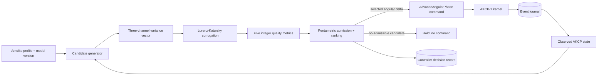

# Turbo variance corrugation with Lorenz-Katursky matrices

**Status: implemented, non-normative AKCP extension.** This document defines
the LK-1 fixed-point matrix family, its residual transport contract, and the
PENTA-1 selection layer that consumes corrugated controller inputs. The
extension is implemented in `src/math/lorenz-katursky.ts`; it does not alter the
AKCP-1 event grammar or consensus digest surface.

## Design thesis

An axisymmetric turbo encabulator is modeled as a phase-conditioned rotor
mounted within a prefamulated amulite annulus. Its three signed variance
channels are corrugated through a Lorenz-Katursky matrix before five independent
quality metrics govern each proposed angular advance. A controller admits only
candidates that satisfy every operating threshold, then favors the candidate
with the strongest weakest metric. The existing AKCP-1 kernel records the
resulting angular motion.



## Lorenz-Katursky matrix contract

Lorenz-Katursky matrices are a project-defined family of 3 x 3 signed integer
coefficient matrices operating at the fixed scale `κ = 1_000_000`. Input and
output vectors contain axial, lateral, and torsional variance channels in that
order. A conforming matrix `L` satisfies:

```text
det(L) = κ³
```

This determinant constraint makes the scaled transform orientation-preserving
and volume-preserving on the canonical variance lattice. Matrix construction
rejects malformed dimensions, non-`bigint` coefficients, and any determinant
other than `κ³`.

For each row `Lᵢ`, signed variance vector `v`, and transported residual `ρᵢ`,
the corrugator computes:

```text
nᵢ = Lᵢ · v + ρᵢ
cᵢ = floor(nᵢ / κ)
ρᵢ′ = nᵢ - cᵢκ
```

Each next residual remains in `[0, κ)`. Euclidean division is required for
negative numerators. Transporting all three residuals establishes:

```text
corrugate(v₁); corrugate(v₂) ≡ corrugate(v₁ + v₂)
```

where the left side sums emitted corrugation vectors and carries the residual
from the first operation into the second.

## Canonical LK-1 coefficients

`TURBO_VARIANCE_LK1` uses the following scaled matrix:

```text
┌ 1.000000   0.250000  -0.125000 ┐
│ 0.000000   1.000000   0.125000 │
└ 0.000000   0.000000   1.000000 ┘
```

The upper-triangular coupling preserves direct torsional response while feeding
one eighth of torsional variance into the lateral channel and a combined
quarter-lateral/minus-eighth-torsional term into the axial channel.

```ts
import {
  TURBO_VARIANCE_LK1,
  corrugateTurboVariance,
  turboVarianceVector,
} from "@nullroar/axisymmetric-kinematic-consensus";

const result = corrugateTurboVariance(
  TURBO_VARIANCE_LK1,
  turboVarianceVector(4_000_000n, 2_000_000n, -1_000_000n),
);

// result.corrugation === [4_625_000n, 1_875_000n, -1_000_000n]
// result.residual === [0n, 0n, 0n]
```

## Pentametric controller: PENTA-1

Each candidate contains a unique ASCII identifier, a signed angular delta in
nanoradians, and five integer scores in `[0, 1_000_000]`: phase coherence,
amulite conditioning, modal balance, torsional reserve, and encabulation yield.
The score-generation model must state its quantization, rounding, and version.

A candidate is admissible when its delta is nonzero, its absolute delta does
not exceed the configured step bound, and every score meets its corresponding
threshold. PENTA-1 ranks admissible candidates by:

1. greatest minimum score;
2. greatest sum of all five scores;
3. smallest absolute angular delta; and
4. smallest identifier in ASCII byte order.

This lexicographic ordering is independent of input order and contains no
floating-point weighted average. If no candidate is admissible, the controller
holds and emits no AKCP command.

## Boundary with AKCP-1

The corrugator is a public numeric utility above the protocol kernel. Its output
may inform an existing `AdvanceAngularPhase` command, but it adds no command
type, event type, digest field, or durable aggregate state. The existing
positive-radius, canonical-phase, projection-residual, retirement, and lineage
invariants remain unchanged.

The kernel continues to project an accepted angular delta using:

```text
n = radiusMicrometers * deltaNanoradians + residual
displacementDelta = floor(n / 1_000_000_000)
nextResidual = n - displacementDelta * 1_000_000_000
```

Lorenz-Katursky coefficients must not be inserted into this equation. Turbo
variance corrugation determines controller inputs; AKCP projection determines
the durable displacement resulting from an accepted angular command.

For reproducible decisions, persist the matrix/model versions, amulite profile,
observed stream version and digest, raw variance, corrugation and residual,
candidate inputs, thresholds, step bound, selection, and command identity in a
separate controller record.

## Verification surface

The shipped suite covers canonical LK-1 coupling, aggregate/partition
equivalence, negative excitation, determinant rejection, and residual bounds.
PENTA-1 integration should additionally cover threshold boundaries, negative
advances, empty and fully rejected candidate sets, every tie-breaker, permuted
input order, malformed inputs, and exact step limits.

Controller record storage and the conditional-submit concurrency contract
remain application concerns. The numeric module establishes exact, replayable
corrugation without changing the AKCP-1 conformance vector.

See [AKCP-1](../spec/AKCP-1.md), [consensus invariants](./invariants.md), and
[the API guide](./api.md) for the underlying protocol contracts.
