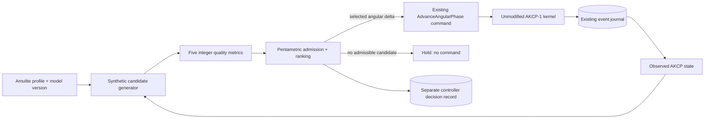

# Turbo encabulation with prefamulated amulite

**Status: fictional, non-normative design proposal.** Turbo encabulation and
prefamulated amulite are used here as engineering satire. The material,
apparatus, and performance quantities below have no demonstrated physical
basis. The pentametric algorithm is an original, proposed discrete selection
rule; no encabulator or controller is implemented by this document.

## Design thesis

An axisymmetric turbo encabulator is theorized as a phase-conditioned rotor
mounted within a prefamulated amulite annulus. Five independent quality metrics
govern each proposed angular advance. A controller admits only candidates that
satisfy every operating threshold, then favors the candidate with the strongest
weakest metric. The existing AKCP-1 kernel records the resulting angular motion.

The intended benefit is a reproducible simulation of a suitably overqualified
machine: every observer given the same candidate set, model, and inputs can
explain why a particular advance was selected.

## Hypothetical apparatus

| Element | Theorized role | Simulation representation |
| --- | --- | --- |
| Prefamulated amulite annulus | Conditions the rotor's encabulation field | Immutable material-profile identifier and synthetic coefficients |
| Axisymmetric rotor | Carries angular motion through the annulus | An existing AKCP aggregate with a positive radial metric |
| Five sensing rings | Observe distinct aspects of encabulation quality | Five explicitly supplied integer scores per candidate |
| Pentametric controller | Selects an admissible angular advance | Pure, versioned candidate-selection function |
| Tangential takeoff | Exposes projected displacement to the operator | Existing AKCP displacement and transported residual |

“Prefamulation” denotes a fictional preparation step that freezes the amulite
profile before a simulation run. A profile is an input fixture, not a measured
material property. Changing it starts a new controller configuration; it does
not silently recalibrate a running decision.



## The five metrics

Each metric is dimensionless and represented as an integer in `[0, 1_000_000]`.
Higher is better. These are invented simulation scores, not sensor units or
validated estimates of efficiency, safety, or material strength.

| Symbol | Metric | Question posed by the model |
| --- | --- | --- |
| P | Phase coherence | How closely does this candidate align the modeled field? |
| A | Amulite conditioning | How well does the candidate fit the selected material profile? |
| M | Modal balance | How evenly does the candidate distribute modeled oscillation? |
| T | Torsional reserve | How much modeled headroom remains after the advance? |
| E | Encabulation yield | How useful is the candidate's modeled output? |

The candidate generator is deliberately an unresolved modeling component. A
first simulator should use published integer fixtures. Any later score formula
must specify its inputs, units, quantization, rounding, and version before it can
claim reproducible decisions. No floating-point calculation is implied here.

## Pentametric algorithm: PENTA-1 proposal

Inputs are a finite candidate set, five minimum thresholds, and a positive
angular step bound. A candidate contains a unique ASCII identifier matching
`[A-Za-z0-9_-]+`, a signed integer delta in nanoradians, and exactly five integer
scores in the order `P, A, M, T, E`.

Validate the entire input before selecting anything:

- Every score and threshold must be an integer in `[0, 1_000_000]`.
- Candidate identifiers must be unique and valid.
- Every delta must be an integer; the step bound must be a positive integer.
- Missing fields, duplicate identifiers, and malformed values reject the
  decision request. They must not be interpreted as zero or a request to hold.

A structurally valid candidate is admissible when its delta is nonzero, its
absolute delta does not exceed the step bound, and all five scores meet their
respective thresholds. Rank admissible candidates by:

1. Greatest minimum score.
2. Greatest sum of the five scores.
3. Smallest absolute angular delta.
4. Smallest identifier in ASCII byte order.

This is a lexicographic rule, not an unspecified weighted average. The final
tie-breaker makes the result independent of input order. Scores, sums, and
angular arithmetic use exact integers; implementations must not use locale
sorting or a runtime's unstable iteration order to break ties.

```text
select(candidates, thresholds, stepBound):
    validate all inputs, rejecting malformed requests
    eligible = candidates satisfying all admission conditions
    if eligible is empty:
        return HOLD
    sort eligible by (-min(scores), -sum(scores), abs(delta), ASCII(id))
    return the first candidate
```

`HOLD` creates no AKCP command or event. It is distinct from retiring an
aggregate and from issuing a zero-delta command. The selector optimizes only
this declared ordering over the supplied finite candidates; it establishes no
global optimum, controller stability, or physical feasibility.

### Worked decision

Use thresholds `(600_000, 600_000, 600_000, 600_000, 600_000)` and a step bound
of `100_000_000` nanoradians. Every candidate below proposes an advance of
`50_000_000` nanoradians, or exactly `0.05` radians.

| Candidate | P | A | M | T | E | Minimum | Sum | Result |
| --- | ---: | ---: | ---: | ---: | ---: | ---: | ---: | --- |
| A | 900000 | 750000 | 800000 | 700000 | 850000 | 700000 | 4000000 | Admissible |
| B | 780000 | 780000 | 800000 | 780000 | 780000 | 780000 | 3920000 | Selected |
| C | 950000 | 950000 | 590000 | 950000 | 950000 | 590000 | 4390000 | Rejected: M below threshold |

B wins because its weakest score exceeds A's, even though A has a higher sum.
C's higher total cannot compensate for a failed individual threshold.

## Boundary with the working protocol

The controller would sit above the existing application/kernel boundary. Its
output can be represented by the existing `AdvanceAngularPhase` command, using
the existing branded integer quantities and `ConsensusEngine.execute` API.
This proposal adds no command type, event type, digest field, or durable AKCP
state. It leaves the positive-radius, canonical-phase, residual, retirement,
and lineage invariants intact.

For a fixed radius, the kernel continues to apply exactly:

```text
n = radiusMicrometers * deltaNanoradians + residual
displacementDelta = floor(n / 1_000_000_000)
nextResidual = n - displacementDelta * 1_000_000_000
```

Use the existing Euclidean arithmetic for negative deltas. Amulite coefficients
must never be inserted into this equation. AKCP's fixed-radius partition
equivalence concerns projection of supplied deltas; it does not imply that an
adaptive controller will select the same deltas when decision intervals change.

For a future implementation, persist a separate decision record containing the
controller/model versions, amulite profile, observed stream version and digest,
candidate inputs, thresholds, step bound, selection, and command identity.
Retries must reuse the same command identity and payload. Calling the current
orchestrator again generates a new command identity, so a shared correlation
identifier alone does not make controller retries idempotent.

AKCP can replay the accepted motion without this separate record. Reproducing
the controller's choice requires the record as well; the AKCP hash chain does
not automatically authenticate external scores or material profiles.

State inspection and command submission are not one atomic operation in the
current public API. If the stream changes after scoring, the scores may be
stale. A future controller needs serialized command ownership or an explicitly
designed conditional-submit contract; the kernel's append concurrency checks
alone do not prove that a selected action used the latest observed state.

## Evidence required before implementation claims

A future simulator should supply fixtures covering threshold boundaries,
negative advances, empty and fully rejected candidate sets, all tie-breakers,
permuted input order, malformed inputs, and exact step limits. Integration
evidence must cover retry identity, stale-state handling, retirement rejection,
and unchanged AKCP-1 conformance.

The score-generation model, controller record storage, concurrency contract,
and any real-world interpretation remain open work. This document ships no
runtime implementation, hardware design validation, or performance result.

See [AKCP-1](../spec/AKCP-1.md), [consensus invariants](./invariants.md), and
[the API guide](./api.md) for the implemented protocol and its actual contracts.
